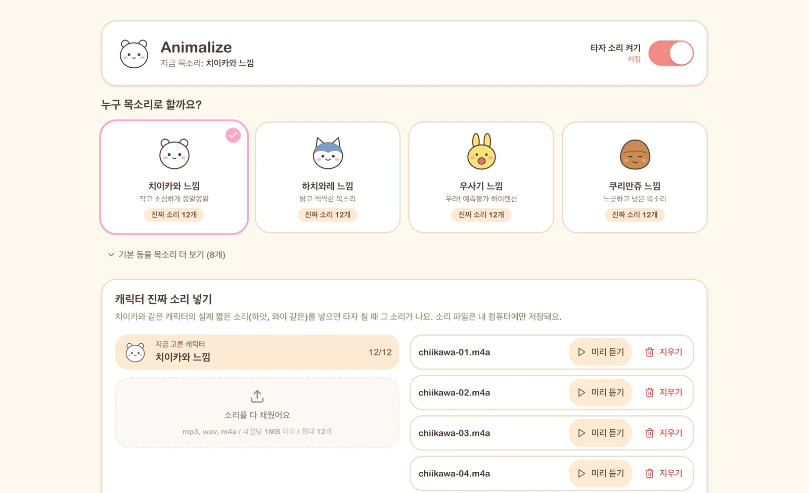

# Animalize

**Every keystroke makes a character talk.**

Each time you press a key, you hear a Chiikawa, Hachiware, Usagi, Momonga, Shisa, Kurimanju or Animal Crossing villager voice. It's free, and it works on Mac, Windows, Linux and Chrome.

**[Go to the homepage and listen](https://indosaram.github.io/animalize/)** · **[Download](https://github.com/Indosaram/animalize/releases/latest)**



## What it does

- **Pick a character:** Chiikawa, Hachiware, Usagi, Momonga, Shisa, Kurimanju, plus Animal Crossing villager voices (4 male, 4 female). Click a card and it plays a sample right away.
- **Works anywhere you type:** messengers, documents, the browser any app.
- **Use your own sounds:** drop short sound files in and they play while you type.
- **Turn it off in one click:** the big switch at the top silences it immediately.
- **Your typing stays on your computer:** keystrokes are only used to pick a sound. Nothing is saved or sent over the internet.

## 1. Download

Download the file that matches your computer.

| My computer | File to download |
|---|---|
| Mac (M1~M4, most Macs bought after late 2020) | [Animalize_0.2.0_aarch64.dmg](https://github.com/Indosaram/animalize/releases/latest/download/Animalize_0.2.0_aarch64.dmg) |
| Mac (Intel, Macs from before 2020) | [Animalize_0.2.0_x64.dmg](https://github.com/Indosaram/animalize/releases/latest/download/Animalize_0.2.0_x64.dmg) |
| Windows 10, 11 | [Animalize_0.2.0_x64-setup.exe](https://github.com/Indosaram/animalize/releases/latest/download/Animalize_0.2.0_x64-setup.exe) |
| Chrome only (no install) | [animalize-chrome-extension.zip](https://github.com/Indosaram/animalize/releases/latest/download/animalize-chrome-extension.zip) |
| Linux | Pick `.deb`, `.AppImage` or `.rpm` on the [download page](https://github.com/Indosaram/animalize/releases/latest) |

> **Not sure if your Mac is M1~M4 or Intel?** Click the Apple menu in the top-left corner of the screen and choose **About This Mac**. If the **Chip** line says something like "Apple M1", download the M1~M4 version. If the **Processor** line says "Intel", download the Intel version.

## 2. Install

### Mac

1. In your Downloads folder, double-click the `Animalize_…dmg` file.
2. When the window opens, drag the Animalize icon into the **Applications** folder next to it.
3. Open Animalize from Launchpad or the Applications folder. The app is certified by Apple, so it opens right away.
4. **Turn on Accessibility (one time only):** to hear sounds when you type in other apps, Animalize needs permission. When the notice appears at the top of the app, click **Open Settings**, then turn on the **Animalize** switch in the list.
   - Even without the permission, sound plays in the app's "Type here to try it" box.

### Windows

1. In your Downloads folder, double-click the `Animalize_…-setup.exe` file.
2. If a blue "Windows protected your PC" window appears, click **More info**, then **Run anyway**.
   - This window appears because this is a free app made by an individual, without a paid Microsoft certificate. It isn't a virus.
3. Click **Next** as prompted to finish installing. Animalize will appear on your desktop.

### Chrome extension

1. Double-click the downloaded `animalize-chrome-extension.zip` to unzip it into a folder.
2. Type `chrome://extensions` into Chrome's address bar and press Enter.
3. Turn on the **Developer mode** switch in the top-right corner.
4. Click **Load unpacked** and choose the folder you unzipped in step 1.
5. Click the puzzle icon to the right of the address bar, then the pin next to Animalize, so the icon always shows. Click the icon to pick a character.
   - No sound plays in password fields.

## 3. How to use it

1. **Pick a character:** click a card to switch to that voice. It plays once so you can hear it.
2. **Set the volume:** drag the volume slider. You can also switch to "Voice only" or "Sound effects only".
3. **When you want quiet:** turn off the big switch at the top. You can also turn it off from the Animalize icon in the menu bar (Mac) or the taskbar (Windows).

## Frequently asked questions

<details>
<summary>No sound when I type in other apps (Mac)</summary>

This happens when the Accessibility permission is off. Go to System Settings → Privacy & Security → Accessibility and turn on Animalize. If it's already on, turn it off and on again, then reopen the app.
</details>

<details>
<summary>Can I use my own sounds?</summary>

Yes. Pick a character, then drop short sound files (mp3, wav or m4a, up to 1 MB each) into the "Add real character sounds" box. Those sounds will play as you type. You can add up to 12 per character.
</details>

<details>
<summary>Is what I type sent anywhere?</summary>

No. Keystrokes are only used to pick a sound. They aren't saved or sent over the internet.
</details>

<details>
<summary>How do I uninstall it?</summary>

On Mac, move Animalize from the Applications folder to the Trash. On Windows, go to Settings → Apps and uninstall Animalize. In Chrome, click Remove for it on `chrome://extensions`.
</details>

<details>
<summary>Is this an official app?</summary>

No. It's a free, non-commercial app made by a fan. The rights to the characters and their voices belong to their creators and the production companies.
</details>

---

## For developers

This is a Tauri 2 (Rust) + React + Vite project. The desktop app and the Chrome extension share the voice engine in `src/engine`.

```bash
bun install
bun tauri dev        # run the desktop app
bun run test         # voice engine tests
bun run build:ext    # build the Chrome extension -> extension/dist
```

- Character voices: `public/banks/<character>/blips.m4a`, synthesized Animal Crossing-style (no recordings). Regenerate with `python3 scripts/synth-voices.py`; each character's voice is set in `VOICES` there.
- Releases: pushing a `v*` tag makes GitHub Actions build for Mac (signed and notarized), Windows, Linux and the Chrome extension, and upload them as a draft release.
- Design tokens: [DESIGN.md](DESIGN.md)

## License and credits

- The app is a non-commercial fan project made for learning and personal use.
- The rights to the character voices and images belong to their respective owners.
- The Korean font is [Pretendard](https://github.com/orioncactus/pretendard) (SIL Open Font License 1.1).
